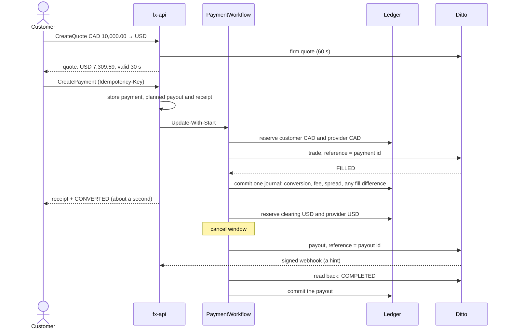

# Corridor

An FX payments product orchestrated with Temporal. A business pays a supplier abroad from its own balance: it gets a quote, accepts it in one call and usually sees the conversion done in about a second, while Corridor converts the money with a provider and pays the supplier over a rail that can take days. Currencies: BRL, CAD, EUR and USD.

Corridor is one of three repositories that run together:

| Repository | Owns |
| --- | --- |
| **corridor** (this one) | Quotes, payments, the payment workflow, people's decisions; and the integration: the local stack, scenarios, the independent verifier and the demo |
| [ledger](https://github.com/xJohnNascimento/ledger) | Accounts, balances, reservations and journal entries, enforced by the database |
| [ditto](https://github.com/xJohnNascimento/ditto) | A simulated FX provider and payout rail that fails on demand |

Corridor is also where the system comes together: its Compose stack runs all three services, and its scenarios, verifier and demo exercise them as one. Terraform for an optional AWS sandbox is in each repository's `infra/`; the shared foundation is here.

| Process | Port (localhost) | Role |
| --- | --- | --- |
| fx-api | 8080 customers, 8081 internal | Quotes, payments, admission; operators, webhooks and the audit export on the internal port |
| fx-worker | none | PaymentWorkflow and its activities |
| fx-dispatch | none | Delivers pending starts, commands and webhook hints to Temporal |
| ledger | 9090 | The ledger's Connect API |
| ditto | 9002 | The provider's HTTP API and its admin API |
| Temporal | 7233, UI 8233 | Durable execution; the UI shows every payment's history |
| PostgreSQL 17 | 5432 | One container, one database per service |

**Status:** the showcase exists end to end: the three services, every failure path, people in the loop, the independent verifier, the demo and Terraform that validates. Every scenario passes with the verifier after each. Versions are on the [Releases page](https://github.com/xJohnNascimento/corridor/releases).

**Next (v2):** scheduled reconciliation, a runtime watchdog, Continue-As-New at safe boundaries, a gated RESUME decision after a termination and a sandbox deployment, planned in [`docs/plan.md`](docs/plan.md).

## How a payment works

Acme sells CAD 10,000.00 to pay a supplier in USD. The fee is CAD 50.00 and the provider's rate 0.7350; the supplier receives USD 7,309.59 and Corridor earns a USD 3.66 spread.



Every arrow that moves money has a stable business reference, so retries, crashes and lost answers never move it twice. When the provider cannot confirm an outcome, the money stays reserved until two people decide from the provider's own evidence.

## What it demonstrates

| Practice | Where |
| --- | --- |
| Durable admission, with Update-With-Start as the fast path and a dispatcher that guarantees the start | [design, section 5](docs/design.md#5-admission) |
| Updates as durable commands; handlers that never block the workflow; two-person decisions bound to exact evidence | [design, sections 7.2 and 8](docs/design.md#72-signals-updates-and-handlers) |
| Signals as verified hints from an idempotent webhook inbox | [design, section 9](docs/design.md#9-webhook-inbox-and-dispatcher) |
| Durable timers: the cancel window and liquidity retries; a cancel and a submission that can never both win | [design, section 6](docs/design.md#6-paymentworkflow) |
| Activity retries as the polling loop | [design, section 7](docs/design.md#7-temporal-rules) |
| Versioning with `GetVersion` and a replay gate in CI | [design, section 7.6](docs/design.md#76-versioning) |
| Versioned contracts between repositories: a tagged ledger API module, a versioned provider API, a consumer-side provider contract suite | [plan, section 4](docs/plan.md#4-releases-between-repositories) |
| An independent verifier (V1–V11), 23 scenarios and checker-negative fixtures | [integration, sections 5–7](docs/integration.md#5-independent-verifier) |

The decisions behind each choice, with the alternatives considered, are in [`docs/adr/`](docs/adr/README.md). What the system deliberately does not claim is in [integration, section 8](docs/integration.md#8-claims-this-system-does-not-make).

## Quick start

Prerequisites: Docker, Make, Go and OpenSSL. Clone Corridor alone: the ledger and Ditto run from their published images.

```bash
git clone https://github.com/xJohnNascimento/corridor.git
```

```bash
cd corridor && make demo
```

The first run writes random local secrets to `.env` (ignored by git), pulls the images, builds Corridor's, starts the stack, seeds it and runs the [five acts](docs/plan.md#9-the-demo), in about six minutes. `make down` stops everything and deletes the data.

To change the ledger or Ditto together with Corridor, clone them next to it and build all three from source with `make demo STACK=up-dev` (or `make up-dev`):

```bash
git clone https://github.com/xJohnNascimento/ledger.git ../ledger
```

```bash
git clone https://github.com/xJohnNascimento/ditto.git ../ditto
```

## Try it by hand

With the stack from the quick start running, the APIs answer on localhost. Corridor's API is Connect, so plain `curl` with JSON works. Amounts are integers in minor units (CAD 10,000.00 is `1000000`). Load the local keys into your shell from the `corridor` directory:

```bash
set -a; . ./.env; set +a
```

Quote CAD 10,000.00 to USD as the seeded customer Acme:

```bash
curl -s localhost:8080/corridor.v1.QuoteService/CreateQuote -H "Authorization: Bearer $FX_CUSTOMER_KEY_ACME" -H "Idempotency-Key: my-quote-1" -H "Content-Type: application/json" -d '{"sellCurrency":"CAD","buyCurrency":"USD","sellAmount":"1000000"}'
```

Pay it within 30 seconds, with the quote's `id`. The answer normally already shows the conversion done:

```bash
curl -s localhost:8080/corridor.v1.PaymentService/CreatePayment -H "Authorization: Bearer $FX_CUSTOMER_KEY_ACME" -H "Idempotency-Key: my-pay-1" -H "Content-Type: application/json" -d '{"quoteId":"QUOTE_ID","beneficiary":{"name":"Northwind Traders","account":"000123456789","bankCode":"NWBKUS33","country":"US"},"remittanceInfo":"invoice 42"}'
```

Follow it with the `paymentId` from the receipt:

```bash
curl -s localhost:8080/corridor.v1.PaymentService/GetTimeline -H "Authorization: Bearer $FX_CUSTOMER_KEY_ACME" -H "Content-Type: application/json" -d '{"paymentId":"PAYMENT_ID"}'
```

Within the 20-second cancel window of the demo profile, cancel it instead:

```bash
curl -s localhost:8080/corridor.v1.PaymentService/RequestCancel -H "Authorization: Bearer $FX_CUSTOMER_KEY_ACME" -H "Idempotency-Key: my-cancel-1" -H "Content-Type: application/json" -d '{"paymentId":"PAYMENT_ID"}'
```

Then look at the same payment from every side:

| Where | How |
| --- | --- |
| Its workflow history | The Temporal UI at `localhost:8233`, workflow `payment/PAYMENT_ID` |
| Its full timeline, including operator events | `docker compose exec fx-api /fx cli payments timeline --payment PAYMENT_ID` |
| The ledger, rebuilt from its journal | `docker compose exec ledger /ledger audit corridor` |
| All three services at once | `make verify` |
| Reviews and two-person decisions | `docker compose exec fx-api /fx cli ops` ([runbooks](docs/runbooks.md)) |

To call the provider directly, see [Ditto's README](https://github.com/xJohnNascimento/ditto#try-it-by-hand). Calls made straight to Ditto inside this stack move the provider's cash without a ledger entry, so `make verify` then reports V9: that is the verifier doing its job. Run Ditto on its own to experiment freely.

## A 10-minute tour for reviewers

1. Read this page and the [decision index](docs/adr/README.md).
2. Run the [quick start](#quick-start). The five acts take under 10 minutes, and each prints what to open.
3. While it runs, open the Temporal UI at `localhost:8233` on the first payment's workflow, and compare it with `docker compose exec fx-api /fx cli payments timeline --payment <payment-id>`.
4. Check any claim against its proof:

| Claim | Proved by |
| --- | --- |
| Money moves exactly once, even with lost replies and crashed workers | Scenarios [S08, S09, S10](scenarios/s_failures.go); invariants [V5, V6](docs/integration.md#5-independent-verifier) |
| One request, one payment, whatever the retries | [S06, S07](scenarios/s_payments.go) |
| A cancel and a submission can never both win | [S05, S12, S15](scenarios/s_failures.go) |
| A trade the provider creates late can never fill a reference Corridor already closed | [S13](scenarios/s_failures.go) |
| A webhook never moves money by itself | [S11](scenarios/s_failures.go) (a correctly signed but false FAILED event) |
| An outcome the provider cannot confirm keeps the money reserved until two people decide from evidence | [S17, S18, S19, S20, S21](scenarios/s_reviews.go) |
| Every balance equals its journal | `ledger audit`; [V1, V2, V3](docs/integration.md#5-independent-verifier) |
| A workflow change cannot break running payments | [S25](scenarios/s_payments.go) and `make replay-break` |
| The checker can fail | [S24](scenarios/s_payments.go) and the [corrupted fixtures](verification/fixtures_test.go) |

Scenarios are listed in [integration, section 6](docs/integration.md#6-integration-scenarios), invariants in [section 5](docs/integration.md#5-independent-verifier).

## Development

| Command | Does |
| --- | --- |
| `make test` | Unit, property, workflow and integration tests (PostgreSQL in containers), the replay gate, and the verifier's own tests |
| `make lint` | golangci-lint on all three Go modules, `workflowcheck`, the verifier's import guard, actionlint and shellcheck |
| `make scenarios VERIFY=1` | Every scenario against the running stack, with the verifier after each; `ONLY=S12` picks some |
| `make verify` | V1–V11 against the running stack |
| `make replay-break` | Shows the replay gate failing an unversioned workflow change and passing the same change behind `GetVersion` |
| `make proto`, `make tf-validate` | Regenerates the API code; validates and lints the Terraform without cloud credentials |

CI runs these checks on every pull request (`proto-check` in place of `proto`), including every scenario on a fresh stack of the published images. Corridor builds against the ledger's published API module (`github.com/xJohnNascimento/ledger/api`) and runs the ledger and Ditto images that `compose.yaml` pins by tag and digest; Renovate proposes each new release as a pull request.

To develop against a local ledger checkout instead of the published module, add a workspace. `go.work` is ignored by git:

```bash
go work init . ./scenarios ./verification ../ledger/api
```

Delete `go.work` and `go.work.sum` to go back to the published module.

Every pull request carries one label that says what merging it releases: `release: major`, `release: minor`, `release: patch` or `release: none`. Once it merges and CI passes on `main`, the next `vX.Y.Z` is tagged, with GitHub release notes and a multi-architecture image on GitHub Container Registry that carries an SBOM and a cosign signature. A change that breaks the API compared with the last release must be labelled `release: major`, or `release: minor` before 1.0. A `v*` tag pushed by hand still releases, after CI passes.

## Configuration

| Setting | Where | Notes |
| --- | --- | --- |
| Corridors, limits, pricing and the two policy profiles | [`deploy/config.yaml`](deploy/config.yaml) | Its content hash is the policy version copied into each payment |
| `FX_PROFILE` | Environment | `demo` (short timers, failpoints) or `production`; `demo` runs only where `FX_ENVIRONMENT=local` |
| `FX_OPERATORS`, `FX_OPERATOR_KEY_<NAME>` | Environment | Who may propose and approve decisions |
| `FX_CUSTOMER_KEY` | Environment | The key `fx cli customers upsert` registers, kept out of process listings |
| Database URLs, ledger and Ditto endpoints and secrets | Environment | Generated into `.env` locally; Secrets Manager in the sandbox ([`infra/README.md`](infra/README.md)) |

## Code layout

| Path | Contents |
| --- | --- |
| [`api/`](api/) | The protobuf contract and its generated Go |
| [`cmd/fx/`](cmd/fx/) | One binary: `api`, `worker`, `dispatch`, `migrate`, `cli` |
| [`internal/`](internal/) | Money and pricing, the payment workflow and activities, the API, the dispatcher, the ledger and provider adapters, the store |
| [`migrations/`](migrations/) | Corridor's schema |
| [`scenarios/`](scenarios/) | The seed, the scenario runner and the demo (its own Go module) |
| [`verification/`](verification/) | The independent checker (its own Go module, importing nothing from `internal/`) |
| [`test/`](test/) | The Temporal spike and the replay corpus |
| [`infra/`](infra/) | Terraform: the shared foundation and Corridor's sandbox |

The conventions behind it are in [design, section 14](docs/design.md#14-code-layout-and-go-conventions).

## Documentation

| Document | Contents |
| --- | --- |
| [`docs/design.md`](docs/design.md) | Product, pricing, statuses, API, admission, the workflow, Temporal rules, human decisions, data model |
| [`docs/integration.md`](docs/integration.md) | References, the accounting of one payment, evidence rules, the verifier, the scenarios |
| [`docs/plan.md`](docs/plan.md) | Milestones and tasks across the three repositories |
| [`docs/runbooks.md`](docs/runbooks.md) | What to do for each review reason and each alert |
| [`docs/adr/`](docs/adr/README.md) | Architecture decisions |
| [`docs/spike.md`](docs/spike.md) | What the Temporal spike checked on the pinned SDK |
| [`infra/README.md`](infra/README.md) | The shared sandbox foundation and Corridor's own deployment |

## License

[MIT](LICENSE)
