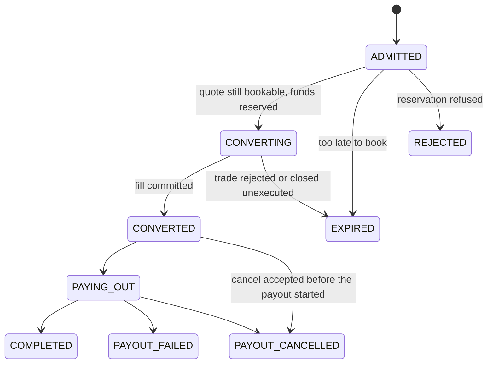
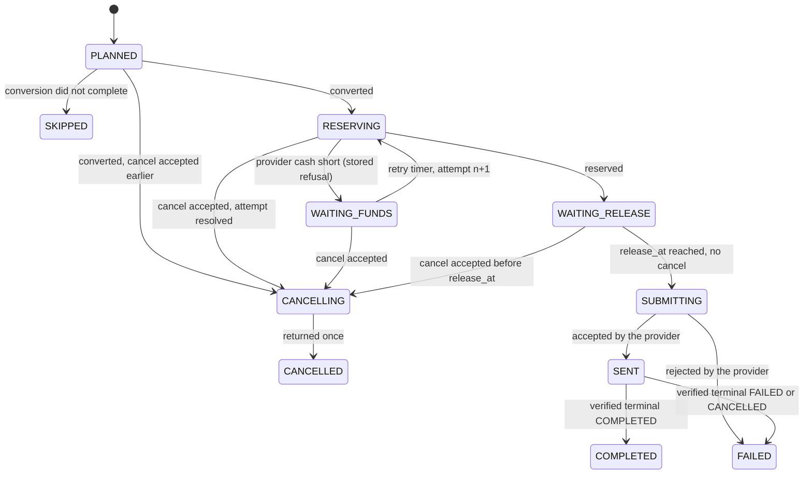

# Corridor: design

Corridor lets a business pay a supplier abroad from its own balance, in the supplier's currency. The customer gets a quote, accepts it in one call and usually sees the conversion done in under a second, while Corridor converts the money back-to-back with an FX provider and pays the supplier over a rail that can take hours or days.

Corridor depends on two other repositories:

- [Ledger](https://github.com/xJohnNascimento/ledger) holds every balance.
- [Ditto](https://github.com/xJohnNascimento/ditto) plays the provider and the rail.

The product is deliberately narrow. It exists to show how Temporal carries a real money flow, with durable timers, people in the loop, external systems that time out, and crashes at the worst moment. How the three services fit together (references, the worked example, the verifier and the scenarios) is in [`integration.md`](integration.md).

## 1. Product

| Built | Design notes only |
| --- | --- |
| Quotes for a fixed sell amount between any enabled pair of BRL, CAD, EUR and USD | Fixed buy amount (pay an exact invoice) |
| One price schedule: fee 50 bps of the amount sold, spread 5 bps on the rate | Customer plans, volume pricing |
| Back-to-back conversion with one provider; fill differences booked | Internal netting, hedging, requotes |
| One payout per payment, cancellable until it is submitted | Rail calendars and cutoffs, returns days later, payout fees |
| Waiting for provider liquidity before a payout | Treasury rebalancing |
| Two-person resolution of every outcome the provider cannot confirm | Customer webhooks and an events feed |
| Scheduled reconciliation and a runtime watchdog | Value dates (Ditto settles instantly) |
| | Compliance: KYC/KYB, sanctions screening, travel-rule data, monitoring, reporting |
| | Local currency rules: BRL, for example, crosses borders only through a foreign-exchange contract with an institution authorized by Brazil's central bank; the simulation treats every pair alike |

Compliance is out of scope on purpose: a real product cannot launch without it, and none of it adds a workflow pattern this design does not already show (a screening hit is one more human decision through the same commands).

A cancellation cancels only the payout. It never reverses a conversion or refunds the fee; the customer keeps the bought currency in their balance.

**Deliverable:** one `fx` image with the subcommands `api`, `worker`, `dispatch`, `migrate` and `cli`, and its own PostgreSQL database. This repository also holds the integration: the Compose stack, the seed manifest, the scenario runner and the independent verifier ([`plan.md`](plan.md)).

## 2. Pricing and quotes

The formulas, rounding and a worked example are in [integration, section 3](integration.md#3-the-worked-example). Every rounding favours Corridor by less than one minor unit. The quote row stores every number and the policy version; an accepted quote is never recomputed from current configuration.

| Rule | Value |
| --- | --- |
| Customer quote lifetime (`QuoteTTL`) | 30 s |
| Provider quote lifetime | 60 s (Ditto) |
| Booking margin | CreateQuote refuses a provider quote that expires before now + `QuoteTTL` + 15 s. This lowers the risk of booking on an expired quote; it does not remove it, which is why expiry is checked again before the trade and resolved by reference after it |
| Fill tolerance | 10 bps of the quoted provider amount. Within it the difference is booked automatically; beyond it the payment goes to review |
| Limits per corridor | Sold amount between 100.00 and 250,000.00 (configuration) |
| Quote rate per customer | 1 per second, burst 5 (a Postgres token bucket shared by every API replica) |

**CreateQuote:**

1. Authenticate the customer and take a token from their bucket.
2. Claim a `product_command` (`CREATE_QUOTE`, customer, Idempotency-Key, request hash); the command's id becomes the quote id. A replay returns the frozen quote, even if it has expired; a new quote needs a new key.
3. Compute fee and net sold, and request a provider quote for the net sold amount, with the quote id as its client reference. Retries reuse that reference, so a lost answer cannot create a second, differently priced provider quote.
4. Price, check the booking margin, freeze the `quote` row and complete the command.

An interrupted CreateQuote is resumed by a same-key retry or simply never completes; it moves no money. Quotes are not workflows: a workflow per priced row would cost history and buy nothing.

## 3. Statuses

**Payment** (what the customer sees):

| Status | Meaning | Terminal |
| --- | --- | --- |
| ADMITTED | The receipt is stored; the workflow is starting or checking the quote | No |
| CONVERTING | Funds reserved, trade in progress | No |
| CONVERTED | Trade filled and booked; the bought amount waits in this payment's clearing account | No |
| PAYING_OUT | The payout is in progress (detail in `payout.status`) | No |
| COMPLETED | The supplier was paid | Yes |
| REJECTED | Not enough funds (customer or provider liquidity) before any trade | Yes |
| EXPIRED | The conversion could not happen at the quoted rate | Yes |
| PAYOUT_FAILED | Converted, but the payout failed; the bought amount is back in the customer's balance | Yes |
| PAYOUT_CANCELLED | Converted, payout cancelled by the customer; the bought amount is back in the customer's balance | Yes |

**Payout** (`payout.status`): PLANNED, RESERVING, WAITING_FUNDS, WAITING_RELEASE, CANCELLING, SUBMITTING, SENT, COMPLETED, FAILED, CANCELLED, SKIPPED. The row is created as PLANNED at admission, so a payout id exists from the first answer.

**Outcome reasons** (terminal only):

| Reason | Payment status |
| --- | --- |
| INSUFFICIENT_FUNDS, LIQUIDITY_UNAVAILABLE | REJECTED |
| RATE_UNAVAILABLE | EXPIRED |
| CUSTOMER_CANCELLED | PAYOUT_CANCELLED |
| BENEFICIARY_ACCOUNT_CLOSED, PAYOUT_REJECTED, RESOLVED_NOT_PAID | PAYOUT_FAILED |

**Review** is an overlay on the payment row (`review_open`, `review_reason`, `review_revision`, `review_opened_at`), never a status, so entering and leaving review does not fight the state machine. The reasons and their decisions are in [section 6.4](#64-review).

Every status write goes through an explicit allowed-transition table and a compare-and-set on the row's current status; terminal statuses are immutable. `version` increments on every write for audit but is never the compare key, so `DecideCommand` writing its decision columns can never make a transition fail. There are no numeric status ranks.





## 4. API

Connect-go (gRPC and HTTP/JSON), package `corridor.v1`, in `api/corridor/v1/`, checked with `buf lint` and `buf breaking`. Customers use port 8080; operators, the console and Ditto's webhooks use port 8081, which is internal only. Every mutating call requires an `Idempotency-Key` header (a client-chosen UUID). Errors carry a Connect code and a stable `reason`; clients branch on the reason.

| RPC | Caller | Does |
| --- | --- | --- |
| `QuoteService.CreateQuote` | customer | `sell_currency, buy_currency, sell_amount` → quote: id, sell, fee, net sold, buy, customer rate, expiry |
| `PaymentService.CreatePayment` | customer | `quote_id, beneficiary {name, account, bank_code, country}, remittance_info` → `receipt` (payment id, payout id, quote id, `ADMITTED`, accepted at) and `payment`, the current snapshot |
| `PaymentService.GetPayment` | customer | The payment with its payout, review flag and any returned amount, from Postgres |
| `PaymentService.GetTimeline` | customer, operator | Events; customers see status events only |
| `PaymentService.RequestCancel` | customer | Stores a cancel command and returns it, normally with its decision (ACCEPTED or REJECTED) already made |
| `CommandService.GetCommand` | customer, operator | A command's state (RECEIVED, ACCEPTED, APPLIED, REJECTED), reason and effects; own commands only |
| `OpsService.ListReviews` | operator | Open reviews, oldest first, from Postgres |
| `OpsService.ProposeResolution` | operator | A decision bound to its evidence ([section 8](#8-human-decisions)) → command |
| `OpsService.ApproveResolution` | operator | `proposal_id, proposal_digest` → command |
| `OpsService.GetReconciliation`, `ListFindings`, `AcknowledgeFinding` | operator | Reports and findings ([section 11](#11-reconciliation-and-watchdog)) |
| `OpsService.ExportSnapshot` | auditor | A consistent read-only snapshot of payments, payouts, trades, evidence, ledger intents and commands, in the same envelope as the ledger's export (header with schema version and capture time, records, trailer with counts and content hash) |
| `POST /webhooks/ditto` | Ditto | Signed provider events, internal port ([section 9](#9-webhook-inbox-and-dispatcher)) |

| Reason | Code | When |
| --- | --- | --- |
| `validation_failed` | invalid_argument | A field breaks its rule, or the Idempotency-Key is missing |
| `idempotency_mismatch` | invalid_argument | The key was already used with a different body |
| `amount_out_of_range`, `corridor_disabled` | failed_precondition | Outside the corridor's limits, or the pair is not enabled |
| `quote_expired` | failed_precondition | The quote's 30 s have passed |
| `quote_used` | already_exists | Another payment used the quote; the details carry its id |
| `not_found` | not_found | Unknown id, or another customer's resource |
| `unauthenticated` | unauthenticated | Missing or unknown credential, or a customer key on the internal port |
| `rate_limited` | resource_exhausted | The customer's quote budget is spent; `Retry-After` in the details |
| `unavailable` | unavailable | Postgres is unreachable; retry with the same key |

A successful CreatePayment means the receipt is durable, not that the conversion happened. Temporal being down does not fail it.

## 5. Admission

The pay call must never create two payments for one request, never leave a payment nobody owns, and usually answer with the conversion already decided.

1. **Validate and authenticate.** Canonicalize and hash the body. Look up `(customer, Idempotency-Key)`: another hash is `idempotency_mismatch`; the same hash is a replay, which skips to step 4.
2. **Admit in one transaction.** Lock the quote; check owner, unused and expiry. Snapshot the beneficiary and the policy. Insert the payment (ADMITTED), its PLANNED payout, its receipt and its first timeline event, with `workflow_start_pending = true`. Commit. A unique violation on the quote is `quote_used`.
3. **Fast path.** Call Update-With-Start: start `payment/<payment-id>` (ID conflict policy USE_EXISTING, ID reuse policy REJECT_DUPLICATE) and send the Update `awaitConversion` with Update id `admission/<payment-id>`. Its handler waits until the conversion is decided or `FastPathWait` passes, whichever is first, and returns the status reached ([section 7.2](#72-signals-updates-and-handlers)). On a successful start, clear `workflow_start_pending`.
4. **Answer** within `FastPathWait` with the stored receipt and the current snapshot from Postgres. The receipt never changes on replays; the snapshot does.

| Failure | Result |
| --- | --- |
| The API dies after step 2 | The dispatcher starts the workflow; the client can replay the key at any time (S07) |
| Temporal is unreachable at step 3 | The answer is still the receipt with status ADMITTED; the dispatcher starts the workflow when Temporal is back |
| Two calls with one key | One admits; the other waits on the unique key and replays |
| Admitted but delayed past the quote | The workflow checks expiry first and ends EXPIRED without a trade |

The dispatcher, not the client, guarantees the start, so there is no "abandoned request" job.

## 6. PaymentWorkflow

One workflow per payment, `payment/<payment-id>`, on task queue `fx`. The payout keeps its own table and state machine inside it. A child workflow would add start, reset and parent-close cases without a benefit at one payout per payment; extract one only if payments gain several payouts or payouts become independently retried products.

**Input:** payment id, customer id, the quote snapshot (every priced number, provider quote id and expiry), payout id, beneficiary id and the policy snapshot ([section 12](#12-configuration-and-policy)). No credentials and no beneficiary details: activities load those when needed, so history holds no personal data.

**Start.** The workflow registers its Update handlers before anything else, then reads the payment and payout rows and resumes from them, so a re-run never writes below the durable state.

**Ordering rule.** The workflow writes a terminal payment or payout status only after the ledger call that status depends on (commit, release or return) has answered. A crash in between leaves a non-terminal row whose retry finds the stored ledger outcome.

### 6.1 Conversion

| Step | Activity | Outcome | Next |
| --- | --- | --- | --- |
| 1 | (in memory) `workflow.Now` against `provider_expires_at − TradeSafety`. A resumed run first re-issues any conversion reserve recorded in `ledger_intent` | Too late, nothing submitted | EXPIRED (RATE_UNAVAILABLE); payout SKIPPED; a reservation found by the re-issued command is released first, so none is left behind |
| 2 | Inside `ReserveConversion`, ensure the payment's clearing account in the bought currency | The account exists | 3 |
| 3 | `ReserveConversion`: customer funds and provider cash in the sold currency, full settlement scope | Reserved | CONVERTING |
| | | Refused on the customer's account | REJECTED (INSUFFICIENT_FUNDS); payout SKIPPED |
| | | Refused on provider cash | REJECTED (LIQUIDITY_UNAVAILABLE), an alert; payout SKIPPED |
| 4 | `SubmitTrade` (provider queue): persist the reference and `submission_started_at`, then post; the provider's create is idempotent by reference, so a retry receives the trade as it stands | FILLED | 6 |
| | | REJECTED or CLOSED | 7 |
| | | Still unknown when the provider quote expires | 5 |
| 5 | `ResolveTrade`: read by reference; if not terminal, close the reference at the provider; retry until a terminal answer | FILLED | 6 |
| | | CLOSED or REJECTED | 7 |
| 6 | Check the fill: currencies, sold amount, reference and provider must match | Delivered amount within tolerance | `CommitConversion` with the difference legs in the same journal; CONVERTED |
| | | Beyond tolerance | Review FILL_OUT_OF_TOLERANCE |
| | | Any other mismatch | Review PROVIDER_CONTRACT_BREACH |
| 7 | `ReleaseConversion` | Released | EXPIRED (RATE_UNAVAILABLE); payout SKIPPED |

The customer's funds in every enabled currency already exist as ledger accounts, created when the customer was onboarded ([section 10](#10-data-model)). A second trade is never created to repair an unknown first one.

### 6.2 Payout

| Step | Activity | Outcome | Next |
| --- | --- | --- | --- |
| 1 | `RecordTransition` out of PLANNED | A cancel was accepted earlier | PLANNED → CANCELLING; cancellation ([6.3](#63-cancellation)) |
| | | Otherwise | PLANNED → RESERVING (attempt 1); payment PAYING_OUT; 2 |
| 2 | `ReservePayout`: payment clearing and provider cash in the bought currency, scope including the customer's funds account in that currency | Reserved | 3 |
| | | Refused on provider cash | WAITING_FUNDS with an alert; a durable timer (`LiquidityRetry`); persist attempt n+1, then 2 |
| | | Refused on clearing | Review LEDGER_UNEXPECTED (clearing holds exactly this amount, so this is a bug) |
| 3 | `SetReleaseTime` once: `release_at = now + CancelGrace` (database clock); WAITING_RELEASE | A timer to `release_at`, racing an accepted cancel | 4, or cancellation |
| 4 | `PrepareSubmit`: under the row locks, move WAITING_RELEASE to SUBMITTING only if the database clock is at or past `release_at` and no cancel was accepted; store `submission_started_at` | Moved | 5 |
| | | Cancel accepted | Cancellation |
| | | Clock not yet there (the worker's timer fired early) | Retry shortly |
| 5 | `SubmitPayout` (provider queue): post; the create is idempotent by reference, so a retry receives the payout as it stands | ACCEPTED, or the payout in a later state | SENT, 6 (a terminal state settles at once) |
| | | REJECTED by the provider | `ReleasePayout` with the return journal; FAILED; payment PAYOUT_FAILED (PAYOUT_REJECTED) |
| 6 | Race `PollPayout` (a retrying read) against provider hints (Signals); every terminal hint starts a `VerifyPayout` read-back that runs beside the poll | Verified COMPLETED | `CommitPayout`; COMPLETED; payment COMPLETED |
| | | Verified FAILED or CANCELLED | `ReleasePayout` with the return journal; FAILED; payment PAYOUT_FAILED (BENEFICIARY_ACCOUNT_CLOSED for AC04, otherwise PAYOUT_REJECTED) |
| | | A hint the read-back does not confirm | Stay SENT and keep waiting |
| | | A different terminal status, or a reference, amount or currency that is not the payout's | Review CONFLICTING_PROVIDER_EVIDENCE |
| | | Poll horizon reached | Review PAYOUT_UNCONFIRMED, reservation intact; the poll and any read-back still running are cancelled |

A read-back never blocks the workflow: a provider that keeps failing it cannot hold back the poll horizon. An answer counts as being about the payout only if it carries the payout's reference, and, for COMPLETED, the payout's currency and exact amount. An answer that ends without payment (FAILED, CANCELLED or REJECTED) or is not final yet may leave the currency and amount out, as a fence on a reference the provider never saw does, but a currency or amount it carries must match.

Provider cash in the bought currency runs short only after an external drain, such as a treasury sweep: each conversion credits it with the provider's delivered amount, which is at least the payout. The same holds for LIQUIDITY_UNAVAILABLE at conversion, because customer deposits are booked into provider cash. Scenarios S14 and S15 therefore drain it between the conversion and the payout reservation.

Neither an HTTP timeout, elapsed time nor a PROCESSING status ever releases or settles money. A late, contradictory provider observation creates a finding; it never silently overwrites an established result.

### 6.3 Cancellation

A cancel is a customer command ([section 8](#8-human-decisions)). Its Update handler never waits on the workflow: it calls `DecideCommand`, which locks the payment and payout rows (the same rows, in the same order, as `PrepareSubmit`) and decides from them with the database clock:

| Payout state when the command is decided | Decision |
| --- | --- |
| PLANNED, RESERVING, WAITING_FUNDS | ACCEPTED; `cancel_accepted_at` is stored on the payout |
| WAITING_RELEASE, before `release_at` | ACCEPTED |
| WAITING_RELEASE at or after `release_at`, SUBMITTING or later | REJECTED (`cancel_window_closed`) |
| CANCELLING, CANCELLED, SKIPPED, or the payment has ended | REJECTED (`already_final`) |
| A cancel is already accepted for the payout and it is not yet cancelled | REJECTED (`cancel_already_accepted`) |

A payout has one canonical cancellation, the first one accepted. A later command with another request key is refused, so exactly one command is ever applied; the same request key replays its own command through the idempotent claim. The release time is compared with the database clock read after the row locks are held, because waiting for them can outlast it.

The handler records the decision in workflow state and returns it. The main loop applies an accepted cancel at the first point where it is safe:

| Where the main loop is | Effect |
| --- | --- |
| Still converting | The conversion continues (a submitted trade cannot be stopped). If it completes, the payout goes PLANNED → CANCELLING and `ReturnUnreservedPayout` returns the bought amount. If it fails, the payout is SKIPPED and the command is APPLIED with no money effect |
| `ReservePayout` in flight | The activity finishes with the reserve command's durable outcome (it retries the same command, never a new attempt). Reserved: `ReleasePayout` with the return. Refused: `ReturnUnreservedPayout` |
| WAITING_FUNDS | No reservation exists (the last attempt was refused durably): `ReturnUnreservedPayout` |
| WAITING_RELEASE | `ReleasePayout` with the return |

The hardest case (S15): a cancel arrives while the payout waits for provider cash and the reply to the latest reserve attempt was lost.

```mermaid
sequenceDiagram
    actor C as Customer
    participant A as fx-api
    participant W as PaymentWorkflow
    participant L as Ledger
    W->>L: ReservePayout, attempt n
    L-->>W: (reply lost after commit)
    C->>A: RequestCancel
    A->>W: executeCommand
    W->>W: DecideCommand: ACCEPTED (payout RESERVING)
    W->>L: ReservePayout, attempt n again (same command)
    L-->>W: stored outcome: reserved
    W->>L: ReleasePayout with the return journal
    W->>W: CANCELLED; payment PAYOUT_CANCELLED
```

If the stored outcome had been a refusal, `ReturnUnreservedPayout` would post the return instead; either way, exactly one return.

Then CANCELLED, payment PAYOUT_CANCELLED (CUSTOMER_CANCELLED), command APPLIED. Exactly one return is ever posted. `CancelPayout` is safe to retry: when its command is already applied and the payout is CANCELLED by it, it succeeds without touching the ledger, and a payout left in CANCELLING continues from there. `PrepareSubmit` refuses whenever `cancel_accepted_at` is set, so a cancel and a submission can never both win (S12). A ledger `GetCommand` NOT_FOUND never selects the unreserved-return path.

### 6.4 Review

Review keeps every reservation intact and waits for a decision by two operators ([section 8](#8-human-decisions)). Every reason has at least one decision, and applying one always checks the evidence again first:

| Review reason | Raised when | Decisions | Applied only when | Result |
| --- | --- | --- | --- | --- |
| FILL_OUT_OF_TOLERANCE | A fill beyond tolerance | ACCEPT_FILL | The provider's trade read matches the proposed fill exactly | `CommitConversion` with the exact difference; CONVERTED |
| PAYOUT_UNCONFIRMED | The poll horizon passed | PAID or NOT_PAID | PAID: a terminal statement line or terminal read matches reference, amount and currency. NOT_PAID: `FencePayout` (cancel by reference) answers CANCELLED or FAILED | PAID: `CommitPayout`; COMPLETED. NOT_PAID: `ReleasePayout` with the return; FAILED; payment PAYOUT_FAILED (RESOLVED_NOT_PAID) |
| CONFLICTING_PROVIDER_EVIDENCE | A read-back contradicts a terminal hint, or differs in reference, amount or currency | PAID or NOT_PAID | As above | As above |
| PROVIDER_CONTRACT_BREACH | A fill with the wrong sold amount or currency, or an idempotency conflict | RETRY_STEP once the provider has corrected its side; for a payout, also NOT_PAID | The step's own evidence rules, run again with the same references | The step's normal outcome |
| LEDGER_UNEXPECTED | A reservation final in an unexpected state, or the clearing reservation refused | RETRY_STEP once an operator has corrected the ledger under its operator scope | The step, run again with the same references, finds the corrected state | The step's normal outcome |
| RECOVERY_REQUIRED | The workflow was cancelled or terminated outside the business flow | RESUME | The watchdog shows no running workflow for the payment | The dispatcher starts a new run, which restores from the durable rows (the only use of workflow id reuse) |

If the provider contradicts an approval, the contradiction is recorded, the approval is not applied and the review stays open. RESUME is decided by the same guarded function as every other command, but run by the dispatcher, because there is no workflow to deliver it to.

RETRY_STEP and RESUME are built in v2 ([plan, section 1](plan.md#1-release-cut)). Until then, PROVIDER_CONTRACT_BREACH, LEDGER_UNEXPECTED and RECOVERY_REQUIRED keep the money reserved and alert; no v1 scenario raises them. A trade-side PROVIDER_CONTRACT_BREACH means the provider moved money outside its contract: it is settled with the provider out of band, then retried. There is deliberately no in-product shortcut.

### 6.5 Code shape

```go
func PaymentWorkflow(ctx workflow.Context, in PaymentInput) (PaymentResult, error) {
	s := newPaymentState(in)
	if err := s.registerHandlers(ctx); err != nil {
		panic(fmt.Errorf("payment %s: %w", in.PaymentID, err))
	}
	next, err := s.run(ctx)
	if temporal.IsCanceledError(err) {
		return PaymentResult{}, s.markRecoveryRequired(ctx, err)
	}
	if err != nil {
		// A case the transition table does not cover is a bug: fail the workflow task, never the payment.
		panic(fmt.Errorf("payment %s: %w", in.PaymentID, err))
	}
	if next != nil {
		return PaymentResult{}, workflow.NewContinueAsNewError(ctx, PaymentWorkflow, *next)
	}
	return s.finish(ctx)
}

func (s *paymentState) markRecoveryRequired(ctx workflow.Context, cause error) error {
	cleanup, _ := workflow.NewDisconnectedContext(ctx)
	cleanup = workflow.WithActivityOptions(cleanup, s.dbOptions())
	_ = workflow.ExecuteActivity(cleanup, acts.MarkRecoveryRequired, s.paymentID).Get(cleanup, nil)
	return cause
}

func (s *paymentState) awaitConversion(ctx workflow.Context) (PaymentStatus, error) {
	_, err := workflow.AwaitWithTimeout(ctx, s.policy.FastPathWait, s.conversionDecided)
	return s.status, err
}

func (s *paymentState) settle(ctx workflow.Context) error {
	pollCtx, cancelPoll := workflow.WithCancel(ctx)
	defer cancelPoll()
	readCtx, cancelReads := workflow.WithCancel(ctx)
	defer cancelReads()
	poll := workflow.ExecuteActivity(s.pollOptions(pollCtx), acts.PollPayout, s.payoutRef())
	var readBacks []workflow.Future
	for {
		var evidence *PayoutEvidence
		var err error
		sel := workflow.NewSelector(ctx)
		sel.AddReceive(s.hints, func(c workflow.ReceiveChannel, _ bool) {
			var hint ProviderHint
			c.Receive(ctx, &hint)
			readBacks = append(readBacks, s.startReadBack(readCtx, hint))
		})
		for _, readBack := range readBacks {
			sel.AddFuture(readBack, func(f workflow.Future) {
				readBacks = remove(readBacks, f)
				evidence, err = s.readBackResult(ctx, f)
			})
		}
		sel.AddFuture(poll, func(f workflow.Future) {
			evidence, err = s.pollResult(ctx, f)
		})
		sel.Select(ctx)
		if err != nil {
			return err
		}
		if evidence != nil {
			return s.applyPayoutEvidence(ctx, *evidence)
		}
		if s.review != nil {
			return nil
		}
	}
}
```

`conversionDecided` is true once the payment is CONVERTED or terminal, or a review is open. `finish` drains remaining hints with `ReceiveAsync` (logging them), waits for `workflow.AllHandlersFinished`, and returns.

## 7. Temporal rules

### 7.1 Activities

Activities are methods on structs that hold their dependencies (store, ledger client, provider adapter). Domain outcomes (refused, rejected, filled) are typed results, not errors; errors mean "retry" or "bug". Every mutating activity uses its stable business reference on every attempt, because an effect may have happened even when the activity timed out, and cancelling an activity never proves the external call stopped.

| Activity | Queue | Start-to-close | Schedule-to-close | Retry |
| --- | --- | --- | --- | --- |
| Database (`RecordTransition`, `ClaimTrade`, `SetReleaseTime`, `PrepareSubmit`, `DecideCommand`, `MarkCommandApplied`, `MarkRecoveryRequired`) | `fx` | 5 s | none | 200 ms, ×2, max 30 s |
| Ledger (`EnsureClearingAccount`, `Reserve*`, `Commit*`, `Release*`, `ReturnUnreservedPayout`) | `fx` | 5 s | none: money waits for the ledger | 500 ms, ×2, max 30 s |
| `SubmitTrade` | `fx-provider` | 10 s | until the provider quote expires | 1 s, ×2, max 10 s |
| `ResolveTrade`, `SubmitPayout`, `VerifyPayout`, `FencePayout` | `fx-provider` | 10 s | none: money waits for the provider | 1 s, ×2, max 1 min |
| `PollPayout` | `fx-provider` | 10 s | `PollHorizon` | `PollInitial`, ×2, max `PollMax` |
| Reconciliation (`CaptureSources`, `Evaluate`, `SaveReport`) | `fx`, `fx-provider` | 5 min | 1 h | 1 s, ×2, max 1 min |

- **Status writes are retry-safe.** Every `RecordTransition` carries a transition key (payment id, step, attempt). It locks the row and checks the expected current status; if the row already shows that key's target state, the retry succeeds without writing. A lost reply never turns into a failed transition.
- An activity with no schedule-to-close gates money; the "money activity retrying" alert fires after `AlertAfter`.
- A provider 429 sets the next retry from `Retry-After` (`NextRetryDelay`).
- `PollPayout` returns a typed retryable error while the payout is not terminal, so its retries are the polling loop and add no history; "still processing" is counted separately from transport errors.
- `fx-provider` has `TaskQueueActivitiesPerSecond` set to 8 as load shaping, leaving room under the provider's quota for quotes ([13.2](#132-capacity)). It smooths the request rate; it does not guarantee an instantaneous HTTP cap, so the 429 handling stays essential.

### 7.2 Signals, Updates and handlers

- **Signals are hints.** `providerHint` carries the event id and the reference. Hints are deduplicated by event id and always confirmed by a read before money moves. One inbox row may produce more than one Signal.
- **Updates carry commands.** `executeCommand(command_id)` (cancel, decisions) uses the command id as its Update id. Validators only check the argument's shape and the initialized state, with no I/O and no credentials. The handler calls `DecideCommand`, which locks the subject, validates against durable state, stores ACCEPTED or REJECTED and returns; the main loop applies the effect and marks the command APPLIED.
- **Handlers never wait on the main loop.** The one exception is `awaitConversion`, the admission fast path, whose wait is bounded by `FastPathWait` (a workflow timer), so it can never hold Continue-As-New or completion for more than seconds. The main loop never waits on a handler.
- Before completing, the workflow waits for `AllHandlersFinished` and drains hints.
- Handler concurrency and completion rules are checked against the pinned SDK by the C0 spike; see Temporal's [Go message passing](https://docs.temporal.io/develop/go/message-passing) guide.

### 7.3 Long histories

Built in v2. At a safe boundary (no mutating activity in flight, every handler finished, hints drained), the workflow continues as new when `GetContinueAsNewSuggested()` is true or the history passes `HistoryLimit`. It carries the statuses, the review, accepted decisions not yet applied, the policy and every durable id; commands stay deduplicated in Postgres across runs. A test uses a tiny limit to force it during a review (S26). Polls and retries live inside activities, so ordinary payments stay far below the limit.

### 7.4 Bugs, cancellation and termination

- A state the transition table does not cover panics: the workflow task fails and retries until a fixed build is deployed (`WorkflowPanicPolicy` set explicitly to `BlockWorkflow`), and an alert fires. A bug never becomes a business failure.
- Temporal cancellation and termination are not business operations. Customers cancel through the cancel command, and humans get read-only access to Temporal in hosted environments. On an unexpected cancellation, the workflow runs `MarkRecoveryRequired` on a disconnected context, keeps every reservation and ends; after a termination nothing runs. Either way the watchdog opens RECOVERY_REQUIRED, and two operators decide whether to RESUME (S23).
- Worker crashes and ordinary replay are supported. Arbitrary resets and history loss are not automatic; the runbook requires evidence before any recovery run. There is no "any reset is safe" promise.

### 7.5 Visibility

Typed search attributes: `PaymentStatus` (Keyword), `InReview` (Bool), `ReviewSince` (Datetime) and `CustomerId` (Keyword). They help inspection in the Temporal UI; they are eventually consistent and never the authority for money or for finding missing work. Queues and alerts read Postgres.

### 7.6 Versioning

- Every change to workflow commands goes behind `workflow.GetVersion`. Old branches stay while any supported history can reach them.
- `test/replay/` holds a committed corpus of histories captured from the scenarios; CI replays it against every pull request with `worker.WorkflowReplayer`, and a nondeterminism error fails the build.
- `make replay-break` shows one incompatible change failing replay and its patched version passing (S25).
- Worker Deployments with pinning or auto-upgrade are a later experiment, not a requirement of the first demo.

## 8. Human decisions

Customers and operators act through **commands**, stored before anything else happens:

1. The API authenticates the actor and writes a `product_command` (actor, Idempotency-Key, operation, subject, request hash), state RECEIVED.
2. The API tries the fast path (the `executeCommand` Update with the command id as Update id) and answers with the command, normally already decided.
3. The dispatcher retries delivery until the workflow answers, so an API or dispatcher crash never loses an accepted request (S21).
4. `DecideCommand` stores ACCEPTED or REJECTED with its reason; the main loop applies the effect and stores APPLIED with the effect ids.

A command whose workflow has already finished gets a durable REJECTED from the same guarded decision function; it never stays RECEIVED because the Update answered NotFound.

**Operators.** Two synthetic operators, `alice` and `bob`, each with their own key on the internal port (an OIDC identity provider in hosted environments). The API is the authentication authority and records the authenticated actor on every command. Credentials never enter Temporal history. A compromised API could impersonate an operator; the threat model says so, and a separate verification service is a production extension.

**Proposals** are immutable and bind: payment, subject kind and id, review reason and revision, decision (ACCEPT_FILL, PAID, NOT_PAID, RETRY_STEP or RESUME), provider reference, currencies and amounts where they apply, evidence id and digest, maker and proposal revision. An approval names the exact proposal and its digest, and must come from the other operator. Superseded proposals, proposals for an older review revision and proposals for another payment are refused. One approval authorizes exactly its bound effect, applied idempotently by decision id and ledger reference.

**Evidence** for PAID is a terminal statement line or a terminal provider read that matches the payout's reference, amount and currency; a support ticket or a PROCESSING status is never enough. NOT_PAID requires the provider's fence to answer CANCELLED or FAILED. RETRY_STEP cites the correction (the ledger's correction entry, or the provider's corrected read). RESUME cites the watchdog's finding.

## 9. Webhook inbox and dispatcher

**Inbox** (`POST /webhooks/ditto` on the internal port):

1. Verify the [Standard Webhooks](https://www.standardwebhooks.com/) signature over the raw body with either active secret, and refuse a timestamp more than 5 minutes off.
2. Insert into `webhook_inbox` on `(provider, event_id)`. The same id with a different payload is a CONFLICT row and an alert. Answer 2xx once the row is stored.
3. The dispatcher signals `providerHint` and marks the row SIGNALLED once Temporal accepts it.

A provider's sequence number advances only from a verified read, never from a hint, so a misleading high-sequence hint cannot hide a later valid one. A hint for a finished payment that contradicts its recorded terminal evidence changes nothing and opens a reconciliation finding.

**Dispatcher** (`fx dispatch`): three independent lanes run concurrently (workflow starts, command deliveries and inbox Signals), so a backlog or a hung Temporal call in one never delays another. Each lane leases rows with `FOR UPDATE SKIP LOCKED`, committing the lease, then calls Temporal outside any transaction. Any number of replicas can run.

A lane claims only as many rows as it handles at once (8) and handles them concurrently, so a row's call starts as soon as its lease is committed. The lease (30 s) covers one call, whose timeout is half of it, plus a margin. A lane whose pass came back full claims again at once; otherwise it waits for the next tick. Rows never tried are claimed before rows that already failed, so a few failing rows cannot starve the rest.

- **Starts:** an "already started" answer (the fast path or an earlier attempt won) marks the start done. Only an approved RESUME starts a closed workflow id again, with reuse policy ALLOW_DUPLICATE_FAILED_ONLY: it allows a new run only after one that failed, was cancelled, was terminated or timed out, so a repeated RESUME after a completed run is refused.
- **Commands and Signals:** a NotFound answer means the workflow is closed or not started. The dispatcher consults the payment row: a pending start is retried; a closed workflow marks the inbox row NO_TARGET, or triggers the command's durable REJECTED.

## 10. Data model

Postgres holds product facts, external evidence, decisions and the customer's read model. It never holds a balance.

| Table | Key columns and constraints |
| --- | --- |
| `customer` | id, name, status, API key hash |
| `customer_account` | customer, currency, ledger account id; unique `(customer_id, currency)`. One row per enabled currency, created at onboarding by `fx cli customers upsert`, which calls the ledger's `EnsureAccount` for each |
| `operator` | id, name, API key hash |
| `quote` | customer, request key and hash, every priced number, policy version, provider quote id, provider expiry, expiry; unique `(customer_id, request_key)`; CHECKs restate the pricing identities (`net_sell = sell − fee`, `spread = lp_buy − buy ≥ 0`) |
| `beneficiary` | customer, synthetic name, account, bank code, country, details hash; immutable; unique `(customer_id, details_hash)` |
| `payment` | customer, request key and hash, unique quote (composite FK with customer), beneficiary, payout id, receipt, status, version, last transition key, review columns, outcome reason, policy snapshot, `workflow_start_pending`, start lease |
| `trade` | unique payment, unique provider reference, immutable request, `submission_started_at`, status, fill (provider trade id, delivered amount, rate), evidence id, reservation and entry ids; CHECK: FILLED requires the fill |
| `payout` | unique payment, created PLANNED at admission; amount, currency, beneficiary, clearing account, logical reservation reference, attempt number, reservation id, `release_at` (set once), `cancel_accepted_at` and its command, `submission_started_at`, provider payout id, status, version, last transition key, evidence id, settlement or return entry id. CHECKs: COMPLETED requires terminal COMPLETED evidence; FAILED requires final no-payment evidence; CANCELLED requires an accepted cancel and no submission |
| `provider_evidence` | immutable source kind (read, verified hint, statement line, fence), provider reference, outcome, amounts, sequence or statement position, raw payload, digest; unique source identity |
| `product_command` | unique `(actor_id, request_key)`, operation, subject, request hash, actor, state, reason, delivery lease, accepted and applied times, effect ids |
| `resolution_proposal` | immutable scope and evidence, maker, review reason and revision, proposal revision, supersession, approver and approval command; one approved proposal per `(payment_id, review_revision)` |
| `payment_event` | append-only (a trigger refuses UPDATE and DELETE); unique effect key; customer or operator visibility |
| `webhook_inbox` | PK `(provider, event_id)`, payload hash, reference, received at, status (PENDING, SIGNALLED, NO_TARGET, CONFLICT), lease |
| `ledger_intent` | unique `(namespace, reference)`, operation, payment, immutable request and hash, observed result; no balances |
| `recon_run`, `recon_finding` | source manifest hashes, status (PASS, FAIL, INCOMPLETE), counters, revision; findings OPEN, ACKNOWLEDGED or RESOLVED, unique open per `(invariant, subject)` |
| `rate_bucket` | the per-customer quote buckets |
| `failpoint_arm` | demo profile only: armed failpoints with remaining uses; a hold blocks every attempt until the scenario releases it. Named points: `admission.afterCommit` (S07), `ledger.afterCommit.dropReply` (S08), `ledger.afterCommit.holdReply` (S15), `payout.beforeReserve.hold` (S14, S15), `command.afterAccepted` (S21) |

Roles: `fx_owner` runs migrations; `fx_app` is the runtime role; `fx_audit` is read-only and serves `ExportSnapshot` from one `REPEATABLE READ READ ONLY` transaction.

Amounts are `bigint` minor units with range CHECKs; rates are `bigint` scaled by 10^8. Indexes cover customer listings, pending starts, open reviews, pending inbox rows, unresolved ledger intents and open findings. Beneficiary data is synthetic in this release; real data needs field encryption and a new security review before use.

## 11. Reconciliation and watchdog

Built in v2 ([plan, section 1](plan.md#1-release-cut)); in v1, `make verify` runs the same checks on demand.

`ReconciliationWorkflow`, started by the Schedule `recon` (daily at 06:00 UTC, every 2 minutes in the demo profile, overlap SKIP):

1. `CaptureSources`: the ledger's audit export (through a ledger client with the `audit` scope), a new Ditto statement (after the last one), Corridor's own `ExportSnapshot`, and a Temporal description of every non-terminal payment.
2. `Evaluate`: V1 to V11 using the `verification` module ([integration, section 5](integration.md#5-independent-verifier)), which shares no code with posting or pricing.
3. `SaveReport`: one transaction writes the run and carries findings forward by `(invariant, subject)`.

The watchdog part of V10 flags any non-terminal payment whose workflow is not running, and any start or command pending longer than its policy age; such a payment gets RECOVERY_REQUIRED. Findings appear through `ListFindings` and the console; acknowledging assigns an owner, and resolving requires new evidence.

## 12. Configuration and policy

`config.yaml` holds currencies, enabled corridors with their limits, pricing, provider and ledger endpoints, the house accounts by natural key (resolved to ids at boot with the ledger's `EnsureAccount`) and the two policy profiles. Its content hash is the policy version. The policy is validated at boot and copied into each payment, so a running workflow never reads configuration, and a change never alters an accepted payment.

| Policy | Production | Demo |
| --- | --- | --- |
| `QuoteTTL` | 30 s | 30 s |
| `BookingMargin` | 15 s | 15 s |
| `TradeSafety` | 5 s | 5 s |
| `FillTolerance` | 10 bps | 10 bps |
| `CancelGrace` | 60 s | 20 s |
| `FastPathWait` | 2 s | 2 s |
| `PollInitial`, `PollMax` | 30 s, 15 min | 2 s, 10 s |
| `PollHorizon` | 72 h | 2 min |
| `LiquidityRetry` | 5 min | 10 s |
| `AlertAfter` (with the alerts, C6) | 10 min | 60 s |
| `HistoryLimit` (with Continue-As-New, v2) | 10,000 events | 10,000 (a test sets 50) |

The production deployment refuses the demo profile.

## 13. Operations

### 13.1 Service levels

Production targets over 30 days. The demo measures the same things and prints them; it does not claim them.

| Objective | Target | Measured by |
| --- | --- | --- |
| Pay call answered | 99% within 2.5 s | fx-api request histogram |
| Conversion decided in the first answer | 95%, while the provider and the ledger are healthy | Receipt status versus final status |
| Time to CONVERTED | p99 under 3 s, excluding provider rejections | Timeline timestamps |
| Reads (`GetPayment`, `GetTimeline`) | p99 under 100 ms, with or without workers | fx-api request histogram |
| Payout submitted after `release_at` | p99 under 60 s | Timeline timestamps |
| Webhook to verified status | p99 under 10 s | Inbox receipt to the status event |
| Reviews | None older than 24 h without an owner | `ListReviews` age |
| Reconciliation | A PASS or FAIL report by 07:00 UTC every day | `recon_run` |

### 13.2 Capacity

The provider's quota, not Temporal or the databases, sets the ceiling. Ditto allows 10 requests per second per provider account, like a real provider. A payment's happy path needs about four: the quote, the trade, the payout and one read-back or poll. That gives roughly 2 payments per second per provider account. The `fx-provider` queue runs at 8 activities per second, leaving room for quotes; under pressure CreateQuote answers `rate_limited` with the provider's `Retry-After`, and payments queue on the task queue instead of failing.

Raising the quota raises throughput until the next ceiling: the ledger's provider cash rows, which every payment reserves and commits on. The ledger benchmark measures that ceiling (stretch task L7), and sharding provider cash needs an allocation model first. At these rates, Temporal (a few dozen actions per payment) and PostgreSQL (a few dozen writes per payment) are far from their limits.

### 13.3 Threat model

| Threat | Example | Control | Residual risk |
| --- | --- | --- | --- |
| Spoofing | A forged webhook; a stolen customer key; an impersonated operator | Signature plus a provider read-back before money moves; per-customer keys scoped to their own resources; operator keys on the internal port and two-person approval | A stolen key works until it is revoked; a compromised API could impersonate an operator |
| Tampering | A changed amount in a webhook; a direct database edit | Read-backs compare reference, amount and currency; the ledger's runtime role cannot write tables; timeline and evidence are append-only | An attacker with the ledger's owner role |
| Repudiation | An operator denies an approval | Every command records the authenticated actor; approvals bind the proposal's digest | none known |
| Information disclosure | Beneficiary details in history, logs or metrics | Workflow inputs carry ids only; no personal data in logs, metrics or search attributes; synthetic data only in this release | Anyone with database access sees beneficiary rows |
| Denial of service | A quote flood exhausting the provider quota | Per-customer token buckets; the provider queue's rate; `Retry-After` honoured | A provider outage pauses money, by design |
| Elevation of privilege | One operator resolving money alone; Corridor correcting the ledger | Maker-checker; Corridor's ledger clients carry no operator scope | A compromised operator pair |

### 13.4 Running it

| Area | Design |
| --- | --- |
| Traces (C6) | OpenTelemetry interceptors on Connect and on the Temporal client and worker: one trace from the pay call through the workflow and every activity |
| Metrics (C6) | Temporal SDK metrics plus payments by status, time to CONVERTED, reviews by reason, inbox backlog, pending starts and commands, provider requests and 429s |
| Logs | Structured JSON (`slog`), with workflow ids from the Temporal logger; trace ids arrive with C6. Never beneficiary data |
| Alerts (emitted with C6) | [Review older than 15 min](runbooks.md#review-older-than-15-minutes); [money activity retrying past `AlertAfter`](runbooks.md#money-activity-retrying-past-alertafter); [workflow task failures](runbooks.md#workflow-task-failures); [inbox or dispatch backlog older than 5 min](runbooks.md#inbox-or-dispatch-backlog-older-than-5-minutes); [liquidity wait](runbooks.md#liquidity-wait); [a FAIL or INCOMPLETE reconciliation](runbooks.md#reconciliation-fail-or-incomplete); [RECOVERY_REQUIRED](runbooks.md#provider_contract_breach-ledger_unexpected-recovery_required) |
| Security | Customer API keys (hashed; OAuth 2.0 client credentials would replace them in a hosted product); operator keys on the internal port; ledger and Ditto credentials from the environment or Secrets Manager, never in images or logs; webhook secret rotation with two active secrets; no personal data in history, search attributes, metrics or logs |
| Runbooks | [`runbooks.md`](runbooks.md): one per review reason and per alert, and the bad deploy (roll forward with a `GetVersion` fix) |
| Stretch | A console (Go templates on the internal port: payment timeline, ledger entries, provider outcome, reviews and reconciliation, calling the same handlers as the CLI) and the observability profile (Jaeger, Prometheus, Grafana) |

## 14. Code layout and Go conventions

```
corridor/
├── api/                 the protobuf (proto/corridor/v1) and the generated Go
├── buf.yaml, buf.gen.yaml
├── cmd/fx/               api, worker, dispatch, migrate, cli (customers, payments, failpoints, ops)
├── internal/
│   ├── money/            Amount, Currency, Rate; arithmetic and rounding live only here
│   ├── pricing/          pure quote pricing
│   ├── config/           corridors, limits, pricing and the profiles' policies
│   ├── payment/          PaymentWorkflow, its activities, DecideCommand, approvals and evidence;
│   │                     workflow tests on the time-skipping suite
│   ├── api/              Connect handlers, authentication, admission, the webhook inbox, the export
│   ├── dispatch/         the dispatcher loops: starts, commands, hints
│   ├── ledger/           the ledger client adapter and its failpoints
│   ├── provider/         the provider interface, the Ditto adapter, providertest
│   ├── store/            hand-written pgx queries, one transaction per state change
│   ├── failpoint/        named failpoints, armed in the demo profile only
│   └── pgtest/           a migrated template database per test binary
├── migrations/
├── test/                 the Temporal spike and the replay corpus
├── deploy/postgres/      local database bootstrap
├── verification/         the independent checker, its own Go module
├── scenarios/            seed manifest and scenario runner, its own Go module
├── compose.yaml          pulls the ledger and Ditto images pinned by digest
├── compose.dev.yaml      builds them from sibling checkouts instead
└── infra/
```

| Rule | Enforced by |
| --- | --- |
| Packages by domain; no `workflows`, `activities` or `util` packages | Review |
| Every step returns `error`; a covered domain outcome becomes a status or review inside the step; an uncovered one panics | `errcheck`; a test per transition row |
| Activities are struct methods; workflows reference them through a nil pointer of the struct type | Review |
| Small interfaces declared where they are used; the provider interface is the shared exception, certified by `providertest` | Review |
| Money has its own types; `Add` refuses mixed currencies; conversion uses 128-bit intermediate arithmetic (`math/bits`) | Compiler; property tests |
| Signals, timers and futures race through one `workflow.Selector` | Workflow tests |
| Workflow code logs through `workflow.GetLogger` only | `forbidigo` on `log` and `slog` in workflow files |
| Exhaustive switches over statuses; no clock, map iteration or goroutines in workflow code | `exhaustive`, `workflowcheck` |
| From the ledger, only its `api` module is imported; `verification` imports nothing from `internal/` | `depguard` |

Plus `gofmt`, `goimports`, `ctx` first, errors wrapped with `%w`, and no `init()` with side effects.

## 15. Tests

| Layer | Tool | Covers |
| --- | --- | --- |
| Unit and property | Go tests, `rapid` | Pricing rounding, the transition table, retry-safe transitions, error mapping, money types |
| Workflow | Temporal time-skipping test suite, activities mocked | Every row of the tables in 6.1 to 6.4, cancel at each payout state, cancel racing the release, hints vs polls, Continue-As-New, history bounds, cancellation handling |
| Replay | `worker.WorkflowReplayer` | The committed corpus |
| Integration | testcontainers or the Compose stack | Admission concurrency, the cancel gate, the inbox, dispatcher leases, every status write against real Postgres |
| Provider contract | `providertest` against the pinned Ditto image, on a certification account of its own so its operations never reach Corridor's books | The guarantees in Ditto's design, section 2 |
| Scenarios | The scenario runner | S01 to S26 with the verifier after each ([integration, section 6](integration.md#6-integration-scenarios)) |

## 16. Build tasks

C0 to C6 and P1 to P4 in [`plan.md`](plan.md).
