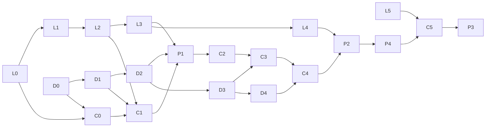

# Work plan

What to build across the three repositories, in which order, and how each piece is checked. There are no dates. Every milestone ends with something that runs, and every task has a "done when" that can be checked.

| Repository | Design | Its tasks |
| --- | --- | --- |
| [ledger](https://github.com/xJohnNascimento/ledger) | [design](https://github.com/xJohnNascimento/ledger/blob/main/docs/design.md) | L0–L7 in its [plan](https://github.com/xJohnNascimento/ledger/blob/main/docs/plan.md) |
| [ditto](https://github.com/xJohnNascimento/ditto) | [design](https://github.com/xJohnNascimento/ditto/blob/main/docs/design.md) | D0–D5 in its [plan](https://github.com/xJohnNascimento/ditto/blob/main/docs/plan.md) |
| corridor (this one) | [`design.md`](design.md), [`integration.md`](integration.md), [`adr/`](adr/README.md) | C0–C6, P1–P4 and I1–I3, below |

A task starts when everything in its "depends on" column is done. A task is done when its code and tests are merged with CI green, its "done when" is shown, and any design it changed is updated in the same pull request.

## 1. Release cut

| Version | Contains | Scenarios | Outcome | Status |
| --- | --- | --- | --- | --- |
| **v1, the showcase** | M0–M4: the three services, every failure path, people in the loop, the verifier, the demo, and the Terraform for a disposable AWS test environment | 23: S01–S21, S24, S25 | `make demo` end to end, `make verify`, every claim in the README backed by a scenario | Done |
| **v2, hardening** | M5: the RETRY_STEP and RESUME decisions, scheduled reconciliation, the runtime watchdog, Continue-As-New, the full scenario runner with the concurrency suite and the evidence bundle, one sandbox deployment | +3: S22, S23, S26 | Outage and termination drills, a release evidence bundle, a deployment record | Not started |
| **Stretch** | M6: the console, the observability profile, the ledger benchmark | none | A visual walkthrough, traces, a measured ceiling | Not started |

Nothing in v1 depends on v2.

## 2. Toolchain

All three repositories pin the same versions, chosen at C0, L0 and D0 as the latest stable releases, and kept in step by Renovate.

| Tool | Use |
| --- | --- |
| Go | All services |
| Temporal Go SDK and the Temporal CLI dev server | Workflows; local server |
| PostgreSQL 17 | One database per service |
| buf, connect-go, protovalidate | The ledger and Corridor APIs |
| pgx, goose | Queries and migrations |
| golangci-lint with `errcheck`, `exhaustive`, `forbidigo`, `depguard`; `workflowcheck` | Lint |
| testcontainers-go, rapid | Integration and property tests |
| Terraform, tflint | `infra/` |
| Renovate | Version and image-digest bumps across repositories |

Why these: [ADR 0012](adr/0012-stack.md).

## 3. Local stack

`make up` starts the whole system with Docker Compose from this repository:

| Service | Port | Source |
| --- | --- | --- |
| PostgreSQL 17 | 5432 | One container with the `ledger`, `fx` and `ditto` databases and their roles |
| Temporal dev server and UI | 7233, 8233 | Search attributes registered at start; persisted to a SQLite file on a volume (`--db-filename`), so a restart keeps every workflow |
| ledger | 9090 | `ghcr.io/xjohnnascimento/ledger`, pinned by digest |
| ditto | 9002 | `ghcr.io/xjohnnascimento/ditto`, pinned by digest, demo profile |
| fx-api | 8080 (customers), 8081 (internal: operators, webhooks, console) | Built from this repository |
| fx-worker, fx-dispatch | none | Built from this repository |
| Migrations | none | One-shot `migrate` containers for each service before it starts |

`make up-dev` uses `compose.dev.yaml` to build the ledger and Ditto from sibling checkouts (`../ledger`, `../ditto`) instead of pulling images, for work that spans repositories.

| Make target | Does |
| --- | --- |
| `up`, `up-dev`, `down` | Start or stop the stack |
| `seed` | Loads `scenarios/seed.yaml` ([integration, section 6](integration.md#6-integration-scenarios)) |
| `demo` | The scripted demo ([section 9](#9-the-demo)); `STACK=up-dev` builds the siblings from source |
| `test` | Unit, property, workflow and integration tests (real PostgreSQL in containers), the replay gate, and the verification module's tests |
| `scenarios` | The scenarios, one at a time; `ONLY=S01,S12` picks some, `VERIFY=1` runs the verifier after each |
| `verify` | V1–V11 against the running stack |
| `replay`, `replay-break` | The replay gate and its red-then-green demonstration |
| `providertest` | The provider contract suite against the running Ditto |
| `spike` | Re-runs the Temporal behaviour checks of C0 against the pinned SDK |
| `lint`, `verification-imports`, `proto`, `proto-check`, `tf-validate` | Static checks, as CI runs them |
| `image` | Builds the `fx` image |

Planned with later milestones: `up-obs` (the observability profile, C6) and `evidence` (the release bundle, v2; [integration, section 7](integration.md#7-checker-negative-tests-and-release-evidence)).

## 4. Releases between repositories

Corridor pins the ledger's image digest and `ledger/api` module version, and Ditto's image digest and OpenAPI version. Renovate opens a pull request for each new release, and Corridor's CI runs the provider contract suite and the scenarios against it before the bump merges. A Corridor task starts on a ledger or Ditto release that contains the task it needs:

| Ledger or Ditto task | Contains | Needed by |
| --- | --- | --- |
| L0, D0 | Skeletons with health checks | C0 |
| L2 | Accounts and journals | C1 |
| D1 | Quotes | C1 |
| L3 | Journals and reservations | P1, C2 |
| D2 | Trades and payouts | P1, C2 |
| D3 | Fences, webhooks, most faults | C3 |
| D4 | Statements, review faults | C4, P2 |
| L4 | Reads and the audit export | P2 |
| L5 | Operator scope | C5 |

## 5. Milestones

### M0. Foundation (v1)

| Id | Task | Done when | Depends on |
| --- | --- | --- | --- |
| L0, D0 | The ledger and Ditto repositories, toolchains, CI and release pipelines (their plans) | Each publishes a signed image from a release tag | none |
| C0 | This repository: the root Go module with the full API contract (`api/proto/corridor/v1`) linted and generated (the `verification` and `scenarios` modules arrive with P2 and P1), Makefile, `compose.yaml` and `compose.dev.yaml`, GitHub Actions (lint, unit, integration, image build; release images on tags), `depguard` rules, Renovate, README stub, and a Temporal spike (`make spike`) that checks on the pinned SDK every behaviour the design relies on: Update-With-Start with a bounded waiting handler, validator rejections leaving no history, activity retries adding no history, `GetContinueAsNewSuggested`, `TaskQueueActivitiesPerSecond` across workers, `AllHandlersFinished`, `IsCanceledError` with disconnected cleanup, ID reuse policies | A pull request runs green; `make up-dev` and `make up` report every service healthy; the spike's results are recorded in [`spike.md`](spike.md); branches with a forbidden import, a missing status case and `time.Now` in workflow code each fail lint | L0, D0 |

### M1. Walking skeleton: one payment end to end (v1)

| Id | Task | Done when | Depends on |
| --- | --- | --- | --- |
| L1–L3 | Ledger journals and reservations (its plan) | Released (its plan) | L0 |
| D1, D2 | Ditto quotes, trades and payouts (its plan) | Released (its plan) | D0 |
| C1 | Schema, money types and pricing; CreateQuote with its command and provider quote; customers (`fx cli customers upsert`, with ledger accounts in every enabled currency), operators, authentication and tenancy | The worked example prices exactly; another customer's quote answers `not_found`; concurrent same-key quotes create one provider quote | C0, L2, D1 |
| P1 | Seed manifest (four currencies, provider cash, demo customers) and the scenario runner skeleton with per-scenario customers | `make seed` makes the ledger's provider cash equal Ditto's balance in every currency; `make scenarios ONLY=S01` runs | C1, L3, D2 |
| C2 | Admission (payment and PLANNED payout, Update-With-Start fast path), the dispatcher's start loop, PaymentWorkflow happy path (conversion, payout with polling), retry-safe transitions, reads, the failpoint framework, the replay corpus, the CI replay gate and `make replay-break` | S01 passes for every enabled corridor; S06, S07 and S25 pass; reads work with the worker stopped | C1, P1 |

**Exit:** `make up && make seed && make scenarios ONLY=S01` passes for every enabled corridor, and the replay gate runs on every pull request.

### M2. Failure depth (v1)

| Id | Task | Done when | Depends on |
| --- | --- | --- | --- |
| D3 | Ditto fences, webhooks and faults (its plan) | Released (its plan) | D2 |
| C3 | Trade resolution and close; fill differences within tolerance; payout rejection and failure returns; customer commands (`RequestCancel`, `GetCommand`, the dispatcher's command loop, `executeCommand` with `DecideCommand`) and cancellation at every payout state; the webhook inbox and hint verification; liquidity waits and attempts; failpoints in the ledger adapter; `providertest` against the pinned Ditto | S02, S03, S04, S05, S08, S09, S10, S11, S12, S13, S14, S15 and S16 pass | C2, D3 |

**Exit:** every scenario that needs no human decision passes.

### M3. People in the loop (v1)

| Id | Task | Done when | Depends on |
| --- | --- | --- | --- |
| D4 | Ditto statements and the remaining faults (its plan) | Released (its plan) | D3 |
| C4 | Operator authentication; proposals and approvals with evidence binding; the ACCEPT_FILL, PAID and NOT_PAID decisions; `fx cli ops` | S17, S18, S19, S20 and S21 pass; FILL_OUT_OF_TOLERANCE, PAYOUT_UNCONFIRMED and CONFLICTING_PROVIDER_EVIDENCE can be resolved from the CLI; every attempt, accepted or refused, is recorded | C3, D4 |

**Exit:** both operators can resolve, from the CLI, every review that a v1 scenario raises.

### M4. Proof and showcase (completes v1)

| Id | Task | Done when | Depends on |
| --- | --- | --- | --- |
| L4, L5 | Ledger reads, audit export and operator scope (its plan) | Released (its plan) | L3 |
| P2 | The `verification` module (V1–V11 as pure functions over the three exports and the Temporal descriptions, INCOMPLETE handling, reports, checker-negative fixtures); Corridor's `ExportSnapshot` with the `fx_audit` role; `make verify` | Each corrupted fixture fails its intended invariant (S24); a truncated statement gives INCOMPLETE; `make verify` passes on the live stack after every v1 scenario | C4, L4, D4 |
| I1, I2, L6, D5 | Terraform for the foundation, Corridor's services and the Temporal Cloud namespace, the ledger and Ditto ([`infra/README.md`](../infra/README.md) and theirs) | `terraform validate` and `tflint` pass in every repository's CI without cloud credentials | C0, L0, D0 |
| P4 | `make demo`, the reviewer tour in the README, runbooks for every alert and review reason, and the READMEs of all three repositories | The demo runs end to end on a clean machine in under 10 minutes; every claim in the README's tour links to its scenario; every alert links to its runbook | P2 |

**Exit (v1):** anyone can clone `corridor`, run `make demo`, and check every claim in the README.

### M5. Hardening (v2)

| Id | Task | Done when | Depends on |
| --- | --- | --- | --- |
| C5 | The RETRY_STEP and RESUME decisions; ReconciliationWorkflow on its Schedule; findings; the watchdog raising RECOVERY_REQUIRED; Continue-As-New at safe boundaries | S22, S23 (with RESUME) and S26 pass; workflow tests cover RETRY_STEP for PROVIDER_CONTRACT_BREACH and LEDGER_UNEXPECTED; a planted mismatch becomes one finding across runs; a `CONTRADICTORY_FINAL_HINT` after completion opens one finding | P4, L5 |
| P3 | The full scenario runner with the verifier after every scenario, the concurrency suite, `make evidence` | S01–S26 pass in CI with V1–V11 after each; the bundle lists any NOT RUN item | C5 |
| I3 | One sandbox deployment: apply the foundation, then the ledger and Ditto, then Corridor; run the seed and S01 as one-off ECS tasks inside the VPC; record the evidence; destroy in reverse order | The evidence is committed | P4, I1, I2, L6, D5 |

### M6. Stretch

| Id | Task | Done when | Depends on |
| --- | --- | --- | --- |
| C6 | The console and the observability profile with its dashboard | A reviewer follows one payment from the console to the ledger and Ditto; one trace spans the pay call to the payout | P4 |
| L7 | The ledger benchmark (its plan) | Results include the hot-account ceiling | L5 |

## 6. Critical path

The ledger's reservations (L3) and Ditto's trades and payouts (D2) gate the walking skeleton. After L0 and D0, the three repositories move in parallel: Corridor's C1 waits only for the ledger's accounts (L2) and Ditto's quotes (D1). The Terraform tasks can run at any point after the foundations.

## 7. Scenario coverage

| Milestone | Scenarios that must pass |
| --- | --- |
| M1 | S01, S06, S07, S25 |
| M2 | S02, S03, S04, S05, S08, S09, S10, S11, S12, S13, S14, S15, S16 |
| M3 | S17, S18, S19, S20, S21 |
| M4 | S24, and `make verify` after every v1 scenario |
| M5 | S22, S23, S26, and all scenarios again with the verifier after each |

## 8. Risks

| Risk | Impact | Mitigation | Where |
| --- | --- | --- | --- |
| Temporal behaves differently than the design assumes (a waiting Update handler with Update-With-Start, retries adding no history, the Continue-As-New suggestion) | Rework of the workflow after code exists | The spike checks every assumption on the pinned SDK before the workflow is written | C0 |
| The ledger's PL/pgSQL routines are hard to get right | Money bugs at the core | Concurrency tests on real PostgreSQL, property tests against an independent model, and the deferred trigger as a backstop that fails closed | L1–L3 |
| Releasing across repositories slows the walking skeleton | Delay | `make up-dev` builds sibling checkouts; releases happen only at the points in section 4 | C0 |
| Too much scope to finish | Nothing complete to show | The v1 cut; stretch labels; every milestone ends with something that runs | Section 1 |
| Failure scenarios become flaky | Nobody trusts CI | Deterministic barriers and failpoints instead of sleeps; scenarios run one at a time; repetition lives in a separate concurrency suite | P1, P3 |
| The local stack outgrows a laptop | The demo does not run | One PostgreSQL container for three databases; observability optional; images for ARM64 and AMD64 | C0 |
| The sandbox keeps running and costing money | Money | Databases scale to zero; destroy after collecting evidence; the cost estimate in `infra/README.md` | I3 |

## 9. The demo

`make demo` runs five acts against the local stack and prints where to look in the Temporal UI and in each service's records:

1. **A payment in about a second.** Quote, pay, CONVERTED in the first answer; the payout completes behind it after the cancel window. The act ends by printing the run's pay-call and time-to-CONVERTED percentiles.
2. **Things break.** A lost trade reply with a killed worker, a webhook storm, a silent provider and a cancel racing the release; every payment ends exactly once.
3. **People in the loop.** A payout whose status API never confirms: a NOT_PAID proposal refused by the provider's fence, then PAID from the statement line, approved by a second operator.
4. **Proof.** `make verify` prints V1–V11 PASS; a corrupted fixture makes it fail on the right invariant.
5. **Versioning.** `make replay-break`: red without `GetVersion`, green with it.
